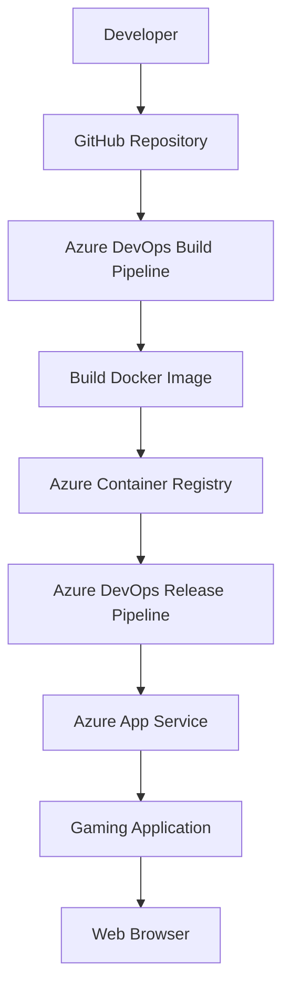

# Azure DevOps CI/CD – Gaming Application Deployment

## Overview

This project demonstrates an end-to-end **CI/CD implementation for a containerized gaming application** using Microsoft Azure cloud infrastructure and Azure DevOps.

The application is deployed through an automated pipeline that integrates GitHub source control, Docker containerization, Azure Container Registry (ACR), and Azure App Service.

The objective is to automate application build, container image creation, image storage, and deployment, enabling developers to deliver application updates efficiently and consistently.

## Architecture



## Technology Stack

- **Microsoft Azure**
- **Azure DevOps**
- **Azure Pipelines**
- **GitHub**
- **Docker**
- **Azure Container Registry (ACR)**
- **Azure App Service**
- **Git**
- **CI/CD Automation**

## Project Workflow

### 1. Source Code Management

- Application source code is maintained in a GitHub repository.
- Developers commit and push code changes to GitHub.
- Repository changes trigger the automated build pipeline.

### 2. Continuous Integration – Build Pipeline

The Azure DevOps build pipeline automates the following operations:

- Retrieves source code from GitHub.
- Builds the application.
- Creates a Docker container image.
- Pushes the generated image to Azure Container Registry (ACR).

### 3. Container Image Management

Azure Container Registry serves as the centralized repository for storing and managing the Docker images generated by the build pipeline.

### 4. Continuous Deployment – Release Pipeline

The deployment pipeline retrieves the container image from Azure Container Registry and deploys it to Azure App Service.

This automates the application release process and reduces manual deployment effort.

### 5. Application Validation

After deployment:

- Access the application through its Azure-hosted URL.
- Verify that the application is running successfully.
- Make a test code change in GitHub.
- Verify that the CI/CD pipeline is triggered automatically.
- Validate that the updated application is deployed successfully.

## Azure Resources

The project uses the following cloud resources and configurations:

- Azure Resource Group
- Azure Container Registry
- Azure App Service
- Azure DevOps Organization and Project
- GitHub Repository
- Azure DevOps Service Connections
- Build Pipeline
- Release/Deployment Pipeline

## Prerequisites

- Active Microsoft Azure subscription
- Azure DevOps account and organization
- GitHub account
- Docker
- Git
- Azure Container Registry
- Azure App Service
- Required Azure DevOps service connections
- Appropriate permissions to create and manage Azure resources

## Implementation Steps

1. Create an Azure Resource Group.
2. Provision Azure Container Registry.
3. Create an Azure DevOps organization and project.
4. Connect the GitHub repository to Azure DevOps.
5. Configure the Azure Container Registry service connection.
6. Configure the build pipeline.
7. Build the Docker image and push it to ACR.
8. Configure the deployment/release pipeline.
9. Deploy the container image to Azure App Service.
10. Access and validate the deployed application.
11. Push a test code change to GitHub.
12. Verify automated build and deployment execution.

## CI/CD Pipeline

The automated deployment workflow follows this sequence:

```text
Code Change
    ↓
GitHub Commit / Push
    ↓
Azure DevOps Build Pipeline
    ↓
Application Build
    ↓
Docker Image Creation
    ↓
Push Image to Azure Container Registry
    ↓
Deployment Pipeline
    ↓
Deploy Container to Azure App Service
    ↓
Application Validation
```

## Key Learning Outcomes

- Implementing end-to-end CI/CD automation.
- Integrating GitHub with Azure DevOps.
- Building and managing Docker container images.
- Working with Azure Container Registry.
- Deploying containerized applications to Azure App Service.
- Configuring Azure DevOps service connections.
- Automating application deployment workflows.
- Understanding cloud-based application hosting.
- Validating automated build and deployment pipelines.
- Working with cloud infrastructure and deployment services.

## Project Purpose

This project simulates a cloud deployment workflow for a gaming application where continuous delivery and application availability are important for delivering reliable user experiences.

The implementation demonstrates how cloud infrastructure and CI/CD automation can streamline application development, deployment, and updates.

---

**Author:** Anushree Sindagi

**GitHub:** https://github.com/Anushree195
